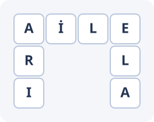

# Word Grid Level Generator

**Procedural level design for word-based puzzle games using constraint-based search.**

A compact Python tool for constructing word-grid levels automatically. Given a set of words and a board size, it searches for layouts that respect word-placement constraints, supports connected puzzles, and exports selected layouts for inspection or integration into a game pipeline.

<p align="center"></p>

## Features

- **Configurable boards:** choose the word list and grid dimensions.
- **Constraint validation:** horizontal/vertical placement, shared letters at crossings, no conflicting or accidental neighboring words.
- **Connected mode:** by default, each additional word must intersect the existing group.
- **Seeded generation:** repeatable layouts for testing and iteration.
- **Variant exploration:** sample multiple seeds, remove duplicate grids, and rank candidates by simple geometry metrics.
- **Practical exports:** text for the terminal, JSON for game pipelines, and SVG for visual review.
- **No runtime dependencies:** Python standard library only.

## Quick start

Requires Python **3.10+**.

```bash
git clone https://github.com/YOUR_USERNAME/word-grid-level-generator.git
cd word-grid-level-generator
python -m pip install -e .

# Explore a small puzzle
wordgrid --words AİLE ELA ARI --rows 3 --cols 4 --seed 42
```

Example output (seeded):

```text
     0  1  2  3
 0   A  İ  L  E
 1   R  ·  ·  L
 2   I  ·  ·  A
```

Explore multiple candidate levels:

```bash
wordgrid --words CODE DATA GAME MODEL --rows 10 --cols 10 \
  --count 5 --trials 100 --format json --output levels.json
```

Export a graphical preview:

```bash
wordgrid --words AİLE ELA ARI --rows 3 --cols 4 \
  --format svg --output level.svg
```

Disable the shared-letter requirement when designing independent word groups:

```bash
wordgrid --words CODE DATA --rows 7 --cols 7 --allow-disconnected
```

> If no level is found, adjust `--trials`, `--max-nodes`, grid dimensions, or the word list. A failed bounded search is not proof that a layout is impossible.

## Research focus

**Question:** Can a bounded, randomized constraint search produce valid, varied, and reproducible word-grid levels for a fixed word set? The project studies this through deterministic seeds, explicit placement constraints, candidate ranking, and repeatable multi-seed experiments. This is an algorithm engineering exploration, not a study of player behavior.

## How it works

Each word is represented by a start coordinate and an orientation (right or down). The generator sorts words by length, samples candidate positions in a seeded order, validates each candidate against current letters and adjacency rules, then recursively backtracks on conflicts. It favors matching-letter intersections without claiming globally optimal designs.

For variant generation, trials use successive seeds. Complete grids are deduplicated and ranked using **intersections**, **compactness**, and **bounding-box area**. These describe layout geometry only; they are *not* empirically validated gameplay difficulty scores.

See [algorithm notes](docs/methodology.md) for the formal constraints, diagnostics, and research limitations.

## JSON output

Each exported level includes the grid, placement metadata, generator seed, and geometric diagnostics:

```json
{
  "seed": 42,
  "rows": 3,
  "cols": 4,
  "placements": [
    {"word": "AİLE", "row": 0, "col": 0, "orientation": "H"}
  ]
}
```

*Excerpt only. The full schema also includes `grid`, `metrics`, and the other words.* Empty grid cells are `null`, and coordinates are zero-based with a top-left origin.

## Experiments and tests

A tiny reproducible benchmark checks layout discovery on different grid sizes and word sets. It records solution counts under a fixed search budget and geometric metrics for successful boards.

```bash
python -m wordgrid.benchmark --seeds 20 --max-nodes 20000
python -m unittest discover -s tests -v
```

The benchmark results are saved to [`results/benchmark.json`](results/benchmark.json). Example results for **20 seeds per configuration** and a **20,000-node budget**:

| Word set | Board | Searches finding a layout |
| --- | --- | ---: |
| `AİLE, ELA, ARI` | 3×4 | 20/20 |
| `CODE, DATA, GAME, MODEL` | 10×10 | 20/20 |
| `CODE, DATA, GAME, MODEL` | 6×6 | 0/20 |

These are small engineering experiments, **not** difficulty or quality measurements. A failed bounded search does not prove that a valid layout is impossible.

## Project structure

```text
src/wordgrid/
  generator.py       Backtracking and placement validation
  levels.py          Layout sampling, ranking, JSON/SVG export
  cli.py             Command line entry point
  benchmark.py       Reproducible toy experiments
tests/                Unit tests
examples/             Generated example files
docs/methodology.md   Algorithm design and limitations
results/benchmark.json
```

## Scope

This repository focuses exclusively on **procedural word-puzzle level generation**. It requires no external datasets; every example and benchmark can be regenerated locally.

No open-source license is bundled; add one if you want to grant others permission to reuse or modify the code.
